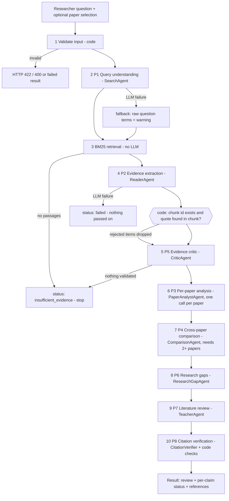
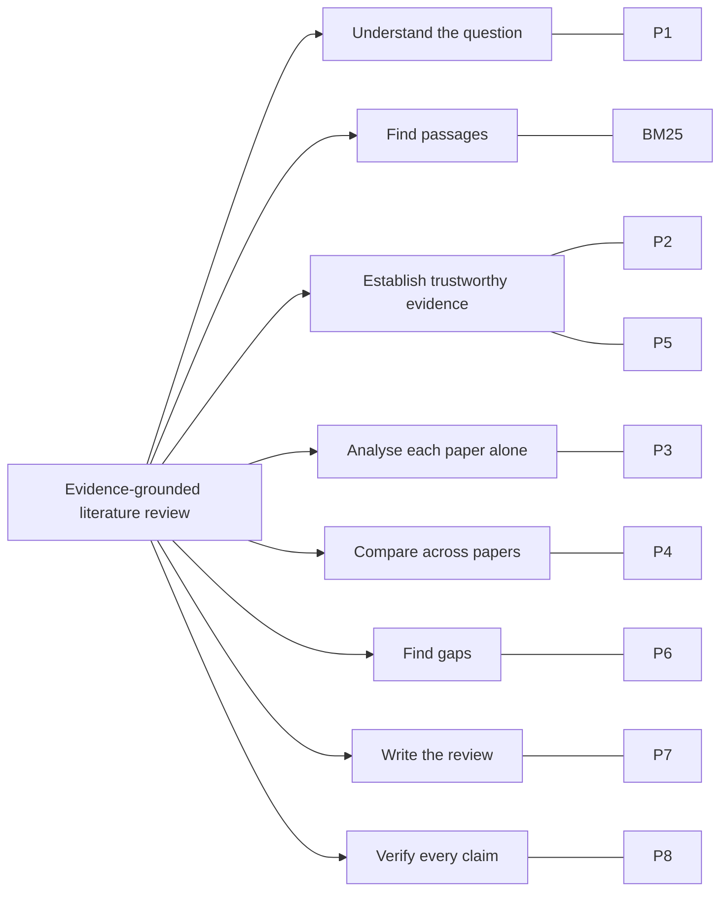
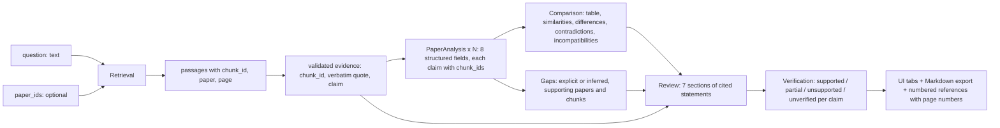
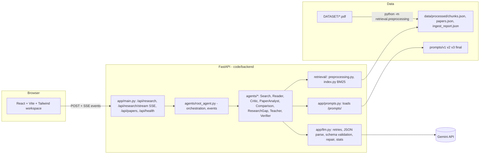
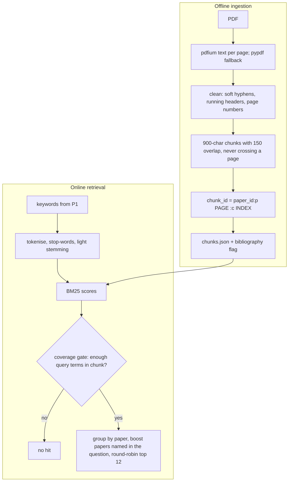
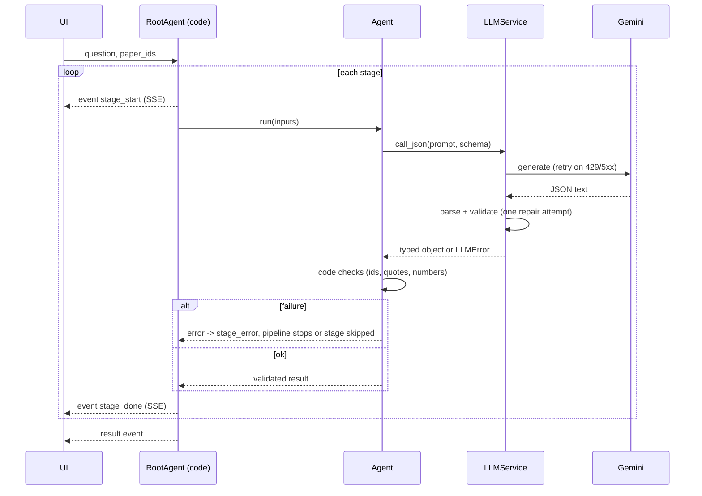

# PaperMind AI - architecture and diagrams

All diagrams are Mermaid and describe the code as built. To get images for the Milestone 2 PDF, paste a block into
https://mermaid.live and export PNG/SVG (the guidelines require diagrams that match what you built and are not copied from the internet).

## 1. Prompt workflow (10 stages, 8 prompts)

## 2. Task decomposition

## 3. Input-output flow

## 4. System architecture

## 5. RAG pipeline

## 6. Agent loop (sequence)

## Design decisions that matter for grading

* **Failures never become facts.** A failed stage raises; the Root Agent stops or skips and says so. The original DebateRAG returned `"Error in X: ..."` strings that flowed into the next agent.
* **Two layers of citation checking.** Code first (ID exists, quote is in the chunk, numbers appear in the cited text), then the P8 verifier for meaning.
* **Gaps are scoped.** `basis` is explicit (authors state it) or inferred; global-novelty wording is flagged; every gap view carries a scope disclaimer.
* **Stateless calls.** No chat history is kept between calls or users (the original agents kept one global chat per agent).
